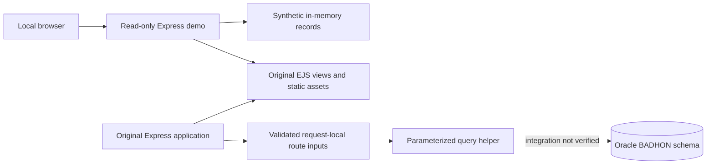

# Badhon
### Blood-donation database coursework · Express · EJS · Oracle

A coursework application for organizing donor records, viewing blood-bank inventory, and browsing blood requests. This prepared checkout includes a **working, database-free UI preview** and a refactored Oracle application layer with synthetic automated tests.

> **Demo, not a deployed healthcare service.** The preview contains only fictional records and is deliberately read-only. Oracle integration is not yet verified; authentication is intentionally unavailable rather than simulated as working.

## Try it in two minutes

From this repository checkout, with **Node.js 22+** and npm:

```sh
cd demo
npm ci --ignore-scripts
npm test
npm start
```

Open **http://127.0.0.1:3000**. No database, login, API key, or Oracle Client is needed. Use `PORT=3001 npm start` if necessary; Ctrl+C stops the server.

## What to explore

| Screen | What it demonstrates |
| --- | --- |
| Home | Clearly labeled synthetic demo and navigation |
| Donor directory | Existing EJS template populated with fictional donor records |
| Blood-group search | Filtering, including the empty-result case |
| Blood-bank inventory | Tabular inventory presentation |
| Request listing | Structured blood-request information |

**A three-minute walkthrough:** open the directory, filter for `A+`, try `AB-` to show an empty result, then inspect inventory and requests. Explain how the original Oracle routes map records into the same listing templates. No form submissions create real records in the preview.

## Architecture



The preview is a separate entry point, not an Oracle mock silently passed off as the full application. It does not import the legacy database routes.

## Engineering improvements in this preparation pass

- **Reproducible preview:** its own pinned dependency lockfile; no native database driver dependency.
- **Safer request handling:** request-local values replace shared mutable state in database workflows; writes are awaited before redirecting.
- **Clear failure paths:** centralized error responses, required-field validation, bound SQL parameters, and connection cleanup.
- **Honest authentication boundary:** login and registration return `501` until secure authentication is implemented, replacing false-success login and plaintext registration behavior.
- **Testable structure:** reusable database and route helpers, syntax checks, synthetic HTTP tests, and an optional container test recipe.
- **Private-by-default execution:** localhost binding and environment-based database configuration; no credentials required for the demo.

## Evidence, not just setup instructions

| Check | Result | What it does **not** establish |
| --- | --- | --- |
| Synthetic UI/helper suite | **13 passed** | Browser visual correctness or Oracle behavior |
| Legacy route suite, database stubbed | **19 passed** | Real database persistence/schema compatibility |
| Demo production dependency audit | **0 known findings at preparation** | A complete security review |
| Docker recipe | Provided, not executed | Container compatibility |

See [full validation and limitations](VALIDATION.md), including the path-resolution defect caught and fixed by the route tests. Chromium screenshot capture was attempted but blocked by the host's socket permissions; no fabricated UI images are included.

## Project map

```text
app.js             Original application entry point
routes/            Oracle workflow routes
util/              Query lifecycle, validation, configuration, and error helpers
views/ + public/   Original interface templates and assets
demo/              Runnable synthetic preview + 13 tests
test/              19 synthetic legacy-route/helper tests
docs/              Detailed setup, safety, and project context
```

[Development setup and Oracle requirements](docs/DEVELOPMENT.md) · [Validation report](VALIDATION.md) · [Demo source](demo/server.js)

## Provenance and remaining work

The original Badhon documentation credits **`@exotisa202`** and identifies the project as **BUET CSE 216, Level 2 Term 2** coursework. Existing package/tutorial attribution and history are preserved. This repository substantially overlaps with the other Badhon/DBMS repository in the account; confirm ownership, team contributions, and which repository is canonical before presenting both as separate portfolio projects.

The original application lives on `master`; `main` contained a placeholder README. This preparation branch does not change repository defaults. Historical data exports, where present, are not used by the demo and require privacy review before further distribution. Do not enter real donor or patient data.

**Before any real deployment:** implement secure authentication/authorization, complete domain validation, review historical dependencies/data, and integration-test the Oracle schema and transactions. These are not completed features.

*Modernization was performed during this portfolio-preparation pass. At the owner's request, commit timestamps retain the prior tip's timestamp; they are not evidence of when the new scaffolding was originally written.*
